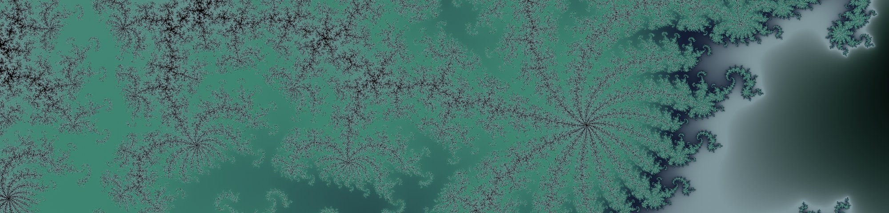
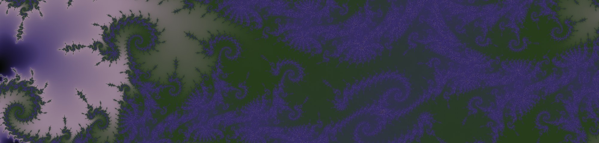
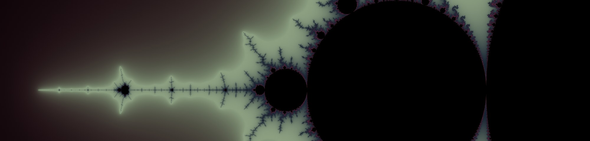
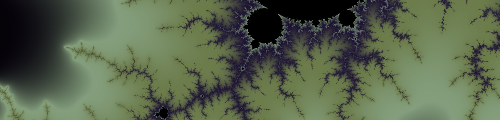
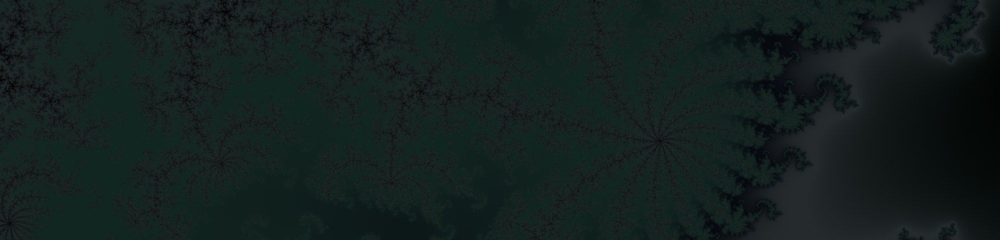

# Mandelbrot Zoom — animated backgrounds for KDE Plasma

An animated Mandelbrot background for KDE Plasma 6 — desktop, lock screen and login
screen — that spans all screens as one picture. Every 30 s it picks a random, interesting spot; each spot drifts slowly
(zoom + pan) and then crossfades into the next one, with a new colour palette per
shot. Rendered on the GPU with perturbation theory, so it zooms to ~10⁻¹⁰.

## Screenshots

Rendered across a dual-screen canvas (3440 + 2560 px side by side, scaled down).
Shown at 70 % brightness so they're visible here; the default is a dim 20 %:






Same spiral at the default 20 % brightness, as it looks on the desktop:



## Install

Requires Plasma 6, Qt 6 and `qt6-shadertools` (for `qsb`).

```sh
make install          # compile shader, install/upgrade plugin for your user, restart plasmashell
make install-system   # same, system-wide (sudo) — needed for the login screen
```

Then pick **Mandelbrot Zoom** under *Configure Desktop and Wallpaper → Wallpaper type*
on every screen, or for all screens at once:

```sh
qdbus6 org.kde.plasmashell /PlasmaShell org.kde.PlasmaShell.evaluateScript \
  'desktops().forEach(d => { d.wallpaperPlugin = "local.mandelbrot"; })'
```

Uninstall: `kpackagetool6 -t Plasma/Wallpaper -r local.mandelbrot`

### Lock screen and login screen

- **Lock screen:** System Settings → Screen Locking → Appearance → wallpaper type
  *Mandelbrot Zoom* (or `kwriteconfig6 --file kscreenlockerrc --group Greeter --key WallpaperPlugin local.mandelbrot`).
- **Login screen** (Plasma Login Manager): the greeter runs as user `plasmalogin` and only
  sees system-wide plugins, so install it globally with `make install-system` (sudo), then
  pick it under System Settings → Login Screen. Repeat `make install-system` after changes.

Both have their own settings, separate from the desktop's.

## Settings

| Setting | Default | |
|---|---|---|
| Seconds per location | 30 | time per shot |
| Crossfade | 3 s | fade to the next shot |
| Movement speed | 15 % | scales zoom and pan of the drift |
| Zoom per location | ×2.0 | zoom over one shot at 100 % speed |
| Max zoom depth | 10 | deepest zoom, 10^-x |
| Brightness | 20 % | |
| Saturation | 60 % | |
| Antialiasing | 2×2 | supersampling (off / 2×2 / 3×3) |
| Full re-render every | 10 s | keyframe interval |
| Max frames per second | 10 | vsync-aligned motion updates |

Settings are stored per screen — keep them identical on all screens so they stay in sync.

**GPU cost** is dominated by the frame rate (full-screen redraws), not the fractal.
At 10 fps it adds roughly 6–8 W over a plain-colour wallpaper on a Radeon R9700.

## How it works

- **Sync without communication:** each screen runs its own copy. Locations are
  seeded from the time slot (`floor(now / interval)`) and all motion is a function
  of wall-clock time, so every screen computes the same picture and draws only its
  part of the bounding box of all screens.
- **Location finder** (`finder.mjs`, WorkerScript thread): zooms step by step towards
  high-iteration (boundary) pixels in double precision, rejects boring views,
  computes the double-precision reference orbit and the palette.
- **Perturbation rendering** (`mandel.frag`): the reference orbit is packed as raw
  float32 bytes into an RGB `Canvas` texture; the shader iterates per-pixel float
  deltas with Zhuoran rebasing.
- **Shader optimisations:** interior points exit early (the derivative ∏2z collapses once
  the orbit falls into an attracting cycle), the main cardioid/bulb are rejected
  analytically when zoomed out, and antialiasing is adaptive — a distance estimate
  decides per pixel whether extra samples are needed (≈40 % less work at 2×2 AA).
- **Cheap animation:** the fractal is only rendered at keyframes, ahead of time into a
  hidden buffer, one strip per frame. In between, the cached texture is just
  scaled/translated to follow the drift.

## Files

```
Makefile                          build shader; install (user) / install-system (global)
plugin/metadata.json              plugin id: local.mandelbrot
plugin/contents/config/main.xml   settings schema
plugin/contents/ui/main.qml       WallpaperItem entry point, maps settings
plugin/contents/ui/MandelView.qml timing, crossfade, keyframes, motion, geometry
plugin/contents/ui/finder.mjs     location search, reference orbit, palettes
plugin/contents/ui/config.qml     settings page
plugin/contents/shaders/mandel.frag (+ .qsb)  fractal shader
docs/screenshots/                 README images
```
